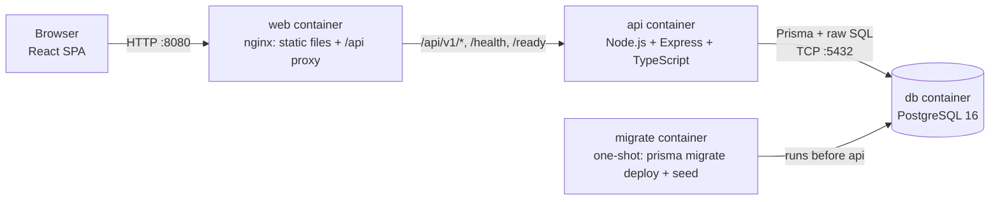
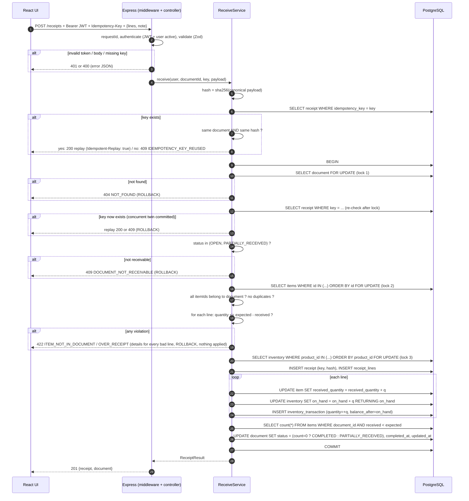
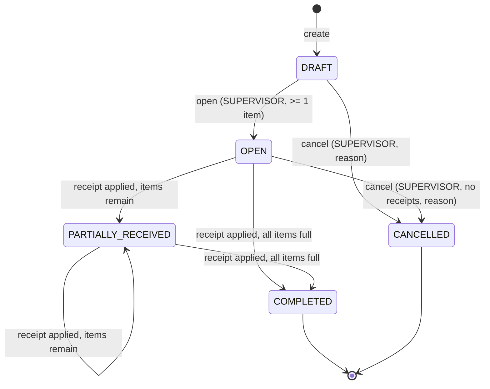

# Technical Specification: Warehouse Receiving System

| | |
|---|---|
| **Version** | 1.0 |
| **Derived from** | `prd.md` (requirement IDs `FR-*`, `NFR-*`, `BR-*`, `US-*` are referenced throughout) |
| **Companion artifacts** | `erd.mmd` (ERD), `openapi.yaml` (API contract), `data-flow.mmd` (data flow) |
| **Audience** | Developers and the AI coding agent. This document is the primary implementation input. |

**Rule for the agent:** if this document and the PRD disagree, stop and report the conflict. Do not guess. If the OpenAPI file and this document disagree on a field or status code, the OpenAPI file wins for the wire format, and this document wins for behavior.

**Decisions that refine the PRD** (previously ambiguous):

| Topic | Decision |
|---|---|
| Unknown `productId` when creating/editing a document | `422 PRODUCT_NOT_FOUND` (not 404, because the URL resource exists). |
| `itemId` that does not belong to the document in a receipt | `422 ITEM_NOT_IN_DOCUMENT`. |
| Invariant | A document in `OPEN` always has zero receipts (the first receipt moves it out of `OPEN`). This is why "cancel OPEN with no receipts" needs no extra query, but the service still verifies it. |
| Idempotent replay body | `receipt` is the stored original. `document` is the current state. |

---

## 1. System Architecture

### 1.1 Components



| Component | Responsibility | Must NOT |
|---|---|---|
| **web** (React + Vite, served by nginx) | UI, client-side validation for UX, attaches JWT, generates idempotency keys, proxies `/api` to the API (same origin, so no CORS needed in Compose). | Contain business rules that are not also enforced by the API. |
| **api** (Express + TS) | Authentication, authorization, request validation, all business rules, transactions, locking, error mapping, logging, health. | Trust the client for role, status, or quantities. |
| **db** (PostgreSQL 16) | Durable storage, constraints, indexes, sequences, triggers (second line of defense). | Be the only place a rule lives. |
| **migrate** (same image as api) | Apply migrations, run idempotent seed, then exit. | Run at API request time. |

### 1.2 API Layering (backend)

```
HTTP request
  -> requestId + pino-http logging
  -> helmet, cors, JSON body limit (100kb)
  -> routes (/api/v1/...)
       -> authenticate (JWT)  -> requireRole(...)  -> validate(zodSchema)
       -> controller (thin: parse, call service, shape response)
            -> service  (ALL business rules, owns the DB transaction)
                 -> repository / Prisma / raw SQL (FOR UPDATE)
  -> errorHandler (AppError | ZodError | Prisma error -> uniform JSON)
```

| Layer | Rule |
|---|---|
| Controller | No business logic. No Prisma calls. |
| Service | Only place that decides allowed/forbidden. Receives plain DTOs, throws `AppError(code, status, message, details)`. |
| Repository | Data access only. Functions that need locks accept a transaction client `tx`. |
| Pure domain helpers | `computeDocumentStatus`, `computeRemaining`, `hashReceiptRequest`, `normalizeSku`. No I/O, 100% unit-tested. |

### 1.3 Repository Layout

```
/
├── AGENTS.md                      # agent instructions (Antigravity reads this)
├── .agent/rules/*.md              # business-rules.md, testing.md
├── .agent/workflows/*.md          # implement-feature.md, verify-inventory.md
├── docs/                          # prd.md, technical-spec.md, erd.mmd, openapi.yaml, ...
├── docker-compose.yml
├── .env.example
├── README.md
├── apps/
│   ├── api/
│   │   ├── Dockerfile
│   │   ├── package.json, tsconfig.json, vitest.config.ts
│   │   ├── prisma/
│   │   │   ├── schema.prisma
│   │   │   ├── migrations/        # 0001_init, 0002_constraints_triggers
│   │   │   └── seed.ts
│   │   └── src/
│   │       ├── server.ts          # bootstrap, graceful shutdown
│   │       ├── app.ts             # express app factory (used by tests)
│   │       ├── config/env.ts      # zod-validated environment
│   │       ├── middleware/        # requestId, authenticate, requireRole, validate, errorHandler, rateLimit
│   │       ├── lib/               # errors.ts, prisma.ts, logger.ts, pagination.ts
│   │       └── modules/
│   │           ├── auth/          # routes, controller, service, schemas
│   │           ├── products/
│   │           ├── documents/     # lifecycle + domain/status.ts
│   │           ├── receipts/      # receive.service.ts (the critical path), domain/hash.ts
│   │           ├── inventory/
│   │           └── health/
│   │   └── tests/                 # unit/, integration/, helpers/
│   └── web/
│       ├── Dockerfile, nginx.conf
│       ├── package.json, vite.config.ts
│       ├── src/ (api/, auth/, pages/, components/, hooks/)
│       └── e2e/                   # Playwright
```

### 1.4 Technology Choices (decision records)

| ADR | Decision | Why | Trade-off |
|---|---|---|---|
| ADR-1 | Plain PostgreSQL in Docker Compose, no Supabase. | One command reproduces everything. Business rules stay in code we control. | Auth is implemented by us (simple JWT). |
| ADR-2 | Express layered architecture, not NestJS. | Less framework to explain in the review. Layers are explicit folders. | Manual wiring. |
| ADR-3 | Pessimistic row locks (`SELECT ... FOR UPDATE`) in `READ COMMITTED`, fixed lock order. | Simple to reason about and prove. Avoids retry loops that `SERIALIZABLE` needs. | Slightly more SQL. Needs a documented lock order. |
| ADR-4 | Idempotency via `receipts.idempotency_key` (unique) + stored payload hash. | Survives restarts, no extra infrastructure (no Redis). | Keys are retained forever. |
| ADR-5 | Balance table (`inventory`) plus append-only ledger (`inventory_transactions`) updated in one transaction. | Fast reads, full audit, testable invariant BR-10. | Two writes per line. A test guards consistency. |
| ADR-6 | Completion is computed by the system, never set by clients. | Makes "no COMPLETED unless fully received" structurally true. | No manual close (see PRD Q-1). |
| ADR-7 | Prisma for schema, migrations and simple queries. Raw SQL (`$queryRaw`) only for locking reads. | Typed models plus the exact locking control we need. | Two query styles. Raw SQL isolated in repositories. |
| ADR-8 | Integer ids in the API. | Simple, readable, enough for scope. | Enumerable ids (acceptable behind auth). |

---

## 2. ERD

The full diagram is in **`erd.mmd`**. Summary:

```
users 1──* products, receiving_documents, receipts, inventory_transactions
products 1──1 inventory
products 1──* receiving_document_items, inventory_transactions
receiving_documents 1──+ receiving_document_items   (UNIQUE document_id, product_id)
receiving_documents 1──* receipts
receipts 1──+ receipt_lines                          (UNIQUE receipt_id, item_id)
receiving_document_items 1──* receipt_lines
receipt_lines 1──1 inventory_transactions            (UNIQUE receipt_line_id)
```

Key constraints (full list in section 3): unique SKU, unique `(document_id, product_id)`, unique `idempotency_key`, `0 <= received_quantity <= expected_quantity`, `on_hand >= 0`, append-only ledger.

---

## 3. Database Design

### 3.1 Conventions

- PostgreSQL 16. Timestamps `timestamptz` (UTC). Names in `snake_case`, mapped from Prisma models with `@@map`/`@map`.
- Primary keys: `SERIAL` integer (Prisma `@default(autoincrement())`).
- Foreign keys use `ON DELETE RESTRICT` (nothing is ever deleted).
- The **Prisma schema is the source of truth for tables and enums**. Constraints Prisma cannot express (CHECK, triggers, sequence defaults) live in a hand-written SQL migration, `0002_constraints_triggers`. The DDL below is the logical reference.

### 3.2 DDL

```sql
-- Enums
CREATE TYPE user_role        AS ENUM ('OPERATOR', 'SUPERVISOR');
CREATE TYPE document_status  AS ENUM ('DRAFT', 'OPEN', 'PARTIALLY_RECEIVED', 'COMPLETED', 'CANCELLED');
CREATE TYPE transaction_type AS ENUM ('RECEIPT');

-- Sequences for human-readable numbers
CREATE SEQUENCE receiving_document_number_seq START 1;
CREATE SEQUENCE receipt_number_seq START 1;

CREATE TABLE users (
  id            SERIAL PRIMARY KEY,
  username      VARCHAR(50)  NOT NULL UNIQUE,
  password_hash VARCHAR(100) NOT NULL,
  full_name     VARCHAR(100) NOT NULL,
  role          user_role    NOT NULL,
  is_active     BOOLEAN      NOT NULL DEFAULT TRUE,
  created_at    TIMESTAMPTZ  NOT NULL DEFAULT now(),
  updated_at    TIMESTAMPTZ  NOT NULL DEFAULT now()
);

CREATE TABLE products (
  id          SERIAL PRIMARY KEY,
  sku         VARCHAR(32)  NOT NULL UNIQUE,
  name        VARCHAR(120) NOT NULL,
  unit        VARCHAR(16)  NOT NULL DEFAULT 'PCS',
  description VARCHAR(500),
  created_by  INTEGER      NOT NULL REFERENCES users(id),
  created_at  TIMESTAMPTZ  NOT NULL DEFAULT now(),
  CONSTRAINT products_sku_format CHECK (sku = upper(sku) AND sku ~ '^[A-Z0-9][A-Z0-9-]{1,31}$')
);

CREATE TABLE inventory (
  product_id INTEGER PRIMARY KEY REFERENCES products(id),
  on_hand    INTEGER     NOT NULL DEFAULT 0,
  updated_at TIMESTAMPTZ NOT NULL DEFAULT now(),
  CONSTRAINT inventory_on_hand_non_negative CHECK (on_hand >= 0)
);

CREATE TABLE receiving_documents (
  id              SERIAL PRIMARY KEY,
  document_number VARCHAR(20)     NOT NULL UNIQUE
                  DEFAULT ('RCV-' || lpad(nextval('receiving_document_number_seq')::text, 6, '0')),
  supplier_name   VARCHAR(120),
  expected_date   DATE,
  notes           VARCHAR(500),
  status          document_status NOT NULL DEFAULT 'DRAFT',
  cancel_reason   VARCHAR(255),
  created_by      INTEGER         NOT NULL REFERENCES users(id),
  opened_by       INTEGER         REFERENCES users(id),
  opened_at       TIMESTAMPTZ,
  cancelled_by    INTEGER         REFERENCES users(id),
  cancelled_at    TIMESTAMPTZ,
  completed_at    TIMESTAMPTZ,
  created_at      TIMESTAMPTZ     NOT NULL DEFAULT now(),
  updated_at      TIMESTAMPTZ     NOT NULL DEFAULT now(),
  CONSTRAINT documents_cancel_reason_required
    CHECK ((status = 'CANCELLED') = (cancel_reason IS NOT NULL))
);

CREATE TABLE receiving_document_items (
  id                SERIAL PRIMARY KEY,
  document_id       INTEGER NOT NULL REFERENCES receiving_documents(id),
  product_id        INTEGER NOT NULL REFERENCES products(id),
  expected_quantity INTEGER NOT NULL,
  received_quantity INTEGER NOT NULL DEFAULT 0,
  CONSTRAINT items_unique_product_per_document UNIQUE (document_id, product_id),
  CONSTRAINT items_expected_range  CHECK (expected_quantity BETWEEN 1 AND 1000000),
  CONSTRAINT items_received_range  CHECK (received_quantity >= 0),
  CONSTRAINT items_no_over_receipt CHECK (received_quantity <= expected_quantity)   -- BR-1 (DB layer)
);

CREATE TABLE receipts (
  id              SERIAL PRIMARY KEY,
  receipt_number  VARCHAR(20) NOT NULL UNIQUE
                  DEFAULT ('RCP-' || lpad(nextval('receipt_number_seq')::text, 6, '0')),
  document_id     INTEGER     NOT NULL REFERENCES receiving_documents(id),
  idempotency_key VARCHAR(64) NOT NULL,
  request_hash    CHAR(64)    NOT NULL,
  note            VARCHAR(255),
  received_by     INTEGER     NOT NULL REFERENCES users(id),
  created_at      TIMESTAMPTZ NOT NULL DEFAULT now(),
  CONSTRAINT receipts_idempotency_key_unique UNIQUE (idempotency_key)               -- BR-7
);

CREATE TABLE receipt_lines (
  id         SERIAL PRIMARY KEY,
  receipt_id INTEGER NOT NULL REFERENCES receipts(id),
  item_id    INTEGER NOT NULL REFERENCES receiving_document_items(id),
  quantity   INTEGER NOT NULL,
  CONSTRAINT receipt_lines_unique_item UNIQUE (receipt_id, item_id),
  CONSTRAINT receipt_lines_quantity_positive CHECK (quantity BETWEEN 1 AND 1000000)
);

CREATE TABLE inventory_transactions (
  id              SERIAL PRIMARY KEY,
  product_id      INTEGER          NOT NULL REFERENCES products(id),
  type            transaction_type NOT NULL,
  quantity        INTEGER          NOT NULL,
  balance_after   INTEGER          NOT NULL,
  document_id     INTEGER          NOT NULL REFERENCES receiving_documents(id),
  receipt_id      INTEGER          NOT NULL REFERENCES receipts(id),
  receipt_line_id INTEGER          NOT NULL UNIQUE REFERENCES receipt_lines(id),
  created_by      INTEGER          NOT NULL REFERENCES users(id),
  created_at      TIMESTAMPTZ      NOT NULL DEFAULT now(),
  CONSTRAINT tx_quantity_non_zero      CHECK (quantity <> 0),
  CONSTRAINT tx_balance_non_negative   CHECK (balance_after >= 0)
);
```

### 3.3 Triggers (migration `0002_constraints_triggers`)

```sql
-- 1) Ledger is append-only (FR-INV-5). TRUNCATE is not blocked, so tests can reset data.
CREATE FUNCTION forbid_mutation() RETURNS trigger AS $$
BEGIN
  RAISE EXCEPTION '% is append-only', TG_TABLE_NAME USING ERRCODE = '23514';
END $$ LANGUAGE plpgsql;

CREATE TRIGGER trg_inventory_transactions_append_only
  BEFORE UPDATE OR DELETE ON inventory_transactions
  FOR EACH ROW EXECUTE FUNCTION forbid_mutation();

-- 2) COMPLETED only if every item is fully received (BR-4, DB layer).
CREATE FUNCTION enforce_completed_fully_received() RETURNS trigger AS $$
BEGIN
  IF NEW.status = 'COMPLETED' AND EXISTS (
       SELECT 1 FROM receiving_document_items i
       WHERE i.document_id = NEW.id AND i.received_quantity < i.expected_quantity
     ) THEN
    RAISE EXCEPTION 'document % cannot be COMPLETED: items remain', NEW.id USING ERRCODE = '23514';
  END IF;
  RETURN NEW;
END $$ LANGUAGE plpgsql;

CREATE TRIGGER trg_documents_completed_guard
  BEFORE INSERT OR UPDATE OF status ON receiving_documents
  FOR EACH ROW EXECUTE FUNCTION enforce_completed_fully_received();
```

The service must update item rows **before** it updates the document status, so the trigger sees final quantities.

### 3.4 Indexes

| Table | Index | Purpose |
|---|---|---|
| products | `UNIQUE(sku)` (implicit) | Lookup, uniqueness. |
| products | `(name)` | Search ordering. (ILIKE search is acceptable at this scale; `pg_trgm` is a documented improvement.) |
| receiving_documents | `UNIQUE(document_number)` (implicit) | Lookup. |
| receiving_documents | `(status, created_at DESC)` | Status filter + newest first. |
| receiving_documents | `(created_at DESC)` | Default list. |
| receiving_document_items | `UNIQUE(document_id, product_id)` (implicit) | Items of a document. |
| receiving_document_items | `(product_id)` | FK lookups. |
| receipts | `UNIQUE(idempotency_key)` (implicit) | Idempotency. |
| receipts | `(document_id, created_at DESC)` | Receipt history. |
| receipt_lines | `UNIQUE(receipt_id, item_id)` (implicit), `(item_id)` | Joins. |
| inventory_transactions | `(created_at DESC, id DESC)` | Default list. |
| inventory_transactions | `(product_id, created_at DESC)` | Product filter. |
| inventory_transactions | `(document_id, created_at DESC)` | Document filter. |

### 3.5 Migration Strategy

1. Tool: **Prisma Migrate**. `prisma migrate dev` creates migrations locally. `prisma migrate deploy` applies them in Docker/CI. Never use `db push` or `migrate reset` outside local development.
2. Migrations are committed and immutable once merged. Fix mistakes with a new migration.
3. `0001_init` is generated from `schema.prisma` (tables, enums, indexes). `0002_constraints_triggers` is hand-written SQL (CHECKs, triggers, sequences and defaults for the number columns).
4. The `migrate` container runs `prisma migrate deploy && node dist/seed.js`, then exits with code 0. The `api` container starts only after `migrate` completed successfully (`depends_on: condition: service_completed_successfully`).
5. `prisma migrate deploy` is idempotent and takes an advisory lock, so repeated or concurrent runs are safe.
6. **Seed (idempotent):** creates users `SEED_OPERATOR_*` and `SEED_SUPERVISOR_*` if missing (never overwrites an existing password). If `SEED_SAMPLE_DATA=true`, creates 5 sample products. Passwords come from the environment, never from source.
7. **Rollback:** forward-only. To roll back, restore the database volume/backup or write a corrective migration. This is documented in the README.

---

## 4. API Contract

The complete contract (paths, schemas, status codes, examples) is **`openapi.yaml`**. This section defines the behavior behind it.

### 4.1 Endpoint Summary

| Method | Path | Roles | Success | Purpose |
|---|---|---|---|---|
| GET | `/health` | public | 200 | Liveness |
| GET | `/ready` | public | 200 / 503 | Readiness (DB + migrations) |
| POST | `/api/v1/auth/login` | public | 200 | Obtain JWT |
| GET | `/api/v1/auth/me` | any | 200 | Current user |
| GET | `/api/v1/products` | any | 200 | List/search products |
| POST | `/api/v1/products` | SUPERVISOR | 201 | Create product + inventory row |
| GET | `/api/v1/products/{id}` | any | 200 | Product detail |
| GET | `/api/v1/receiving-documents` | any | 200 | List (filter `status`, `search`) |
| POST | `/api/v1/receiving-documents` | any | 201 | Create DRAFT |
| GET | `/api/v1/receiving-documents/{id}` | any | 200 | Detail + items + receipts |
| PUT | `/api/v1/receiving-documents/{id}` | any | 200 | Replace header + items (DRAFT only) |
| POST | `/api/v1/receiving-documents/{id}/open` | SUPERVISOR | 200 | DRAFT to OPEN |
| POST | `/api/v1/receiving-documents/{id}/cancel` | SUPERVISOR | 200 | Cancel with reason |
| POST | `/api/v1/receiving-documents/{id}/receipts` | any | 201 / 200 replay | Record receipt |
| GET | `/api/v1/inventory` | any | 200 | Stock per product |
| GET | `/api/v1/inventory-transactions` | any | 200 | Ledger (filters) |

"any" means any authenticated user (`OPERATOR` or `SUPERVISOR`).

### 4.2 Request Validation (Zod, in `validate` middleware)

Validation runs **before** the service, but the service re-checks every business rule against database state (never relying on schema validation alone). Rules per field are in PRD section 6.3 and `openapi.yaml`. Notes:

- Unknown JSON properties are rejected (`.strict()`), so typos do not silently pass.
- Numbers must be JSON integers (not strings). `2.5`, `"5"`, `null`, `NaN` fail.
- SKU is trimmed and uppercased by the schema transform before the regex check.
- Query parameters are coerced and bounded (`page >= 1`, `1 <= pageSize <= 100`). `from` and `to` are validated as dates, and `from <= to`.
- Path `id` must be a positive integer, otherwise `400 VALIDATION_ERROR`.

### 4.3 Error Contract

Single shape (`Error` schema):

```json
{ "error": { "code": "OVER_RECEIPT", "message": "...", "details": [ ... ], "requestId": "uuid" } }
```

| HTTP | Code | When |
|---|---|---|
| 400 | `VALIDATION_ERROR` | Schema/format/range failure. `details[]` lists `{field, issue}`. |
| 400 | `IDEMPOTENCY_KEY_REQUIRED` | Receipt request without `Idempotency-Key` header. (A present but malformed key is `VALIDATION_ERROR`.) |
| 401 | `UNAUTHENTICATED` | Missing, malformed, expired token, or user missing/inactive. |
| 401 | `INVALID_CREDENTIALS` | Login failed. Same message for unknown user and wrong password. |
| 403 | `FORBIDDEN` | Role not allowed. |
| 404 | `NOT_FOUND` | Product, document, or route not found. |
| 409 | `SKU_ALREADY_EXISTS` | Duplicate SKU (pre-check, and Prisma `P2002` for races). |
| 409 | `INVALID_STATE_TRANSITION` | Open/cancel from a status that does not allow it. |
| 409 | `DOCUMENT_NOT_RECEIVABLE` | Receipt on a document not `OPEN`/`PARTIALLY_RECEIVED`. |
| 409 | `DOCUMENT_NOT_EDITABLE` | `PUT` on a non-`DRAFT` document. |
| 409 | `IDEMPOTENCY_KEY_REUSED` | Key already used with a different payload or document. |
| 422 | `OVER_RECEIPT` | A line exceeds remaining quantity. `details[]` has one entry per offending line with `remaining`. |
| 422 | `DUPLICATE_PRODUCT_IN_DOCUMENT` | Same `productId` twice in items. |
| 422 | `DUPLICATE_ITEM_IN_RECEIPT` | Same `itemId` twice in lines. |
| 422 | `ITEM_NOT_IN_DOCUMENT` | `itemId` belongs to another document or does not exist. |
| 422 | `PRODUCT_NOT_FOUND` | Unknown `productId` in document items. |
| 422 | `DOCUMENT_HAS_NO_ITEMS` | Open requested on a document without items (defensive). |
| 429 | `RATE_LIMITED` | Login rate limit exceeded. |
| 500 | `INTERNAL_ERROR` | Anything unexpected, including a database CHECK violation that reached the surface (logged as an error and treated as a bug). No internals in the message. |
| 503 | `NOT_READY` | `/ready` failing. |

**Precedence when several apply to a receipt request:** 401 > 400 (headers/body) > 404 (document) > idempotency replay/409 > 409 (state) > 422 (items/quantities).

### 4.4 Pagination

`{ "data": [...], "meta": { "page", "pageSize", "total", "totalPages" } }`. Sort orders are fixed: products by `sku`, documents by `created_at DESC, id DESC`, inventory by `sku`, transactions by `created_at DESC, id DESC`.

---

## 5. Data Flow

The picture is in **`data-flow.mmd`**. In words:

1. **Read path** (lists, details): Browser, nginx, Express middleware (auth, validation), service, Prisma `SELECT`, JSON DTO back.
2. **Write path** (create/open/cancel): same, but the service opens a transaction, checks state, writes, commits.
3. **Receive path** (critical): the browser sends `POST .../receipts` with an `Idempotency-Key`. The service performs ONE transaction that touches, in order: `receiving_documents` (lock), `receiving_document_items` (lock + update), `inventory` (lock + update), `receipts`, `receipt_lines`, `inventory_transactions` (insert), `receiving_documents` (status update). Either all of it commits or none of it does.
4. **Error path:** any `AppError` becomes the uniform error JSON with the `requestId`. The UI shows `message` and field `details`.

Data ownership: `inventory.on_hand` and `item.received_quantity` are **derived** values that only the receive transaction may change. `inventory_transactions` is the audit truth. Invariant (BR-10): `on_hand = SUM(quantity)` per product.

---

## 6. API Flow: Receiving Workflow

### 6.1 Business workflow (happy path)

1. SUPERVISOR creates products (`POST /products`). SKUs are stored uppercase, `inventory.on_hand = 0`.
2. OPERATOR or SUPERVISOR creates a document (`POST /receiving-documents`). Status `DRAFT`. May edit with `PUT`.
3. SUPERVISOR opens it (`POST .../open`). Status `OPEN`.
4. Truck arrives. OPERATOR records a receipt (`POST .../receipts`). Status becomes `PARTIALLY_RECEIVED` or `COMPLETED`.
5. Repeat step 4 until `COMPLETED`.
6. Anyone views `/inventory` and `/inventory-transactions`.

### 6.2 Sequence: `POST /api/v1/receiving-documents/{id}/receipts`



### 6.3 Step-by-step rules for the receive service

1. **Hash.** `request_hash = sha256(JSON.stringify({ documentId, note: note ?? null, lines: lines sorted by itemId, each {itemId, quantity} }))`, hex encoded. Sorting makes line order irrelevant.
2. **Pre-check (no transaction).** Find a receipt by key. If found: same `document_id` and same hash returns replay (200). Otherwise `409 IDEMPOTENCY_KEY_REUSED`.
3. **Transaction**, isolation `READ COMMITTED`, with a timeout (e.g. 10 s).
4. **Lock order is fixed for the whole codebase:** document, then items (ascending id), then inventory rows (ascending product_id). Every code path that locks more than one of these MUST follow this order. This rules out deadlocks between receipts.
5. **Re-check the key after acquiring the document lock.** Two identical requests serialize on the document lock. The second sees the first's committed receipt and replays instead of inserting.
6. **Same key on two different documents at the same time** cannot be serialized by a document lock. The unique constraint on `idempotency_key` makes one `INSERT` fail with `P2002`. The service catches it, rolls back, and answers `409 IDEMPOTENCY_KEY_REUSED`.
7. **Validate all lines before writing anything.** Collect all violations and return them together. Only then write.
8. **Use relative updates** (`received_quantity = received_quantity + $q`, `on_hand = on_hand + $q`), never write back a value computed in application memory.
9. **Status calculation** (`computeDocumentStatus`): `remainingItems === 0 ? COMPLETED : PARTIALLY_RECEIVED`. Update items first, then the document, so the DB trigger agrees.
10. **Response** is built after commit from fresh reads: the receipt with lines (`balanceAfter` from the ledger rows just inserted), and the full `DocumentDetail`.
11. **Logging:** one `info` log with `requestId`, `documentId`, `receiptId`, `userId`, line count.

### 6.4 Other flows (short)

- **Create/PUT document:** validate; in one transaction verify all products exist (`422 PRODUCT_NOT_FOUND`) and no duplicate products (`422 DUPLICATE_PRODUCT_IN_DOCUMENT`); insert header (number from sequence) and items. `PUT` additionally locks the document row, requires `DRAFT` (`409 DOCUMENT_NOT_EDITABLE`), updates the header, and replaces all items (delete + insert; safe because a `DRAFT` has no receipts).
- **Open:** lock document; require `DRAFT` (else `409 INVALID_STATE_TRANSITION`); require at least one item (`422 DOCUMENT_HAS_NO_ITEMS`); set `OPEN`, `opened_by`, `opened_at`.
- **Cancel:** lock document; require `DRAFT`, or `OPEN` with zero receipts (else `409 INVALID_STATE_TRANSITION`); set `CANCELLED`, `cancel_reason`, `cancelled_by`, `cancelled_at`.
- **Create product:** one transaction: insert product (catch `P2002` as `409 SKU_ALREADY_EXISTS`) and insert `inventory(product_id, 0)`.
- **Login:** find active user by username, compare bcrypt (also compare against a dummy hash when the user is missing, to equalize timing), sign JWT.

---

## 7. State Transitions



Implement as a table in `modules/documents/domain/status.ts`:

```ts
const ALLOWED = {
  DRAFT: ['OPEN', 'CANCELLED'],
  OPEN: ['PARTIALLY_RECEIVED', 'COMPLETED', 'CANCELLED'],
  PARTIALLY_RECEIVED: ['PARTIALLY_RECEIVED', 'COMPLETED'],
  COMPLETED: [],
  CANCELLED: [],
} as const;
```

| Current status | Edit header/items | Receive | Open | Cancel |
|---|:---:|:---:|:---:|:---:|
| DRAFT | Yes | No (409 `DOCUMENT_NOT_RECEIVABLE`) | Yes | Yes |
| OPEN | No (409 `DOCUMENT_NOT_EDITABLE`) | Yes | No (409) | Yes (zero receipts) |
| PARTIALLY_RECEIVED | No | Yes | No | No (409) |
| COMPLETED | No | No | No | No |
| CANCELLED | No | No | No | No |

`COMPLETED` can only be produced by the receive service via `computeDocumentStatus`. No controller or request field can set a status directly.

---

## 8. Authorization

### 8.1 Mechanism

- `POST /auth/login` returns a JWT (HS256). Claims: `sub` (user id), `role`, `iat`, `exp`. Secret `JWT_SECRET` (min 32 chars), lifetime `JWT_EXPIRES_IN` (default `8h`).
- `authenticate` middleware: verifies the token, loads the user by `sub`, rejects if missing or `is_active = false` (`401`), and sets `req.user = { id, role }` **from the database row** (so a role change takes effect immediately).
- `requireRole('SUPERVISOR')` guard per route. Default is deny: any new route must declare its roles explicitly.
- Login rate limit: 10 attempts per minute per IP (`429 RATE_LIMITED`).
- Frontend stores the token in `sessionStorage` (cleared when the tab closes). Trade-off: readable by injected scripts. Accepted for this scope, mitigated by React escaping and a strict CSP from nginx.

### 8.2 Permission Matrix (enforced in backend routes)

| Endpoint | Anonymous | OPERATOR | SUPERVISOR |
|---|:---:|:---:|:---:|
| `GET /health`, `GET /ready` | Yes | Yes | Yes |
| `POST /auth/login` | Yes | Yes | Yes |
| `GET /auth/me` | 401 | Yes | Yes |
| `GET /products`, `GET /products/{id}` | 401 | Yes | Yes |
| `POST /products` | 401 | **403** | Yes |
| `GET /receiving-documents`, `GET .../{id}` | 401 | Yes | Yes |
| `POST /receiving-documents` | 401 | Yes | Yes |
| `PUT /receiving-documents/{id}` | 401 | Yes | Yes |
| `POST .../{id}/open` | 401 | **403** | Yes |
| `POST .../{id}/cancel` | 401 | **403** | Yes |
| `POST .../{id}/receipts` | 401 | Yes | Yes |
| `GET /inventory`, `GET /inventory-transactions` | 401 | Yes | Yes |

Order of checks: authentication (401), then role (403), then input validation (400), then resource existence (404), then state (409), then business rules (422).

---

## 9. Testing Strategy

Full evidence is written to `docs/testing.md`. This section is the requirement for what must be tested.

### 9.1 Levels

| Level | Tooling | Scope | Database |
|---|---|---|---|
| **Unit** | Vitest | Pure domain helpers and Zod schemas: `computeDocumentStatus`, `computeRemaining`, transition table, `hashReceiptRequest` (order-insensitive, sensitive to qty/note/document), `normalizeSku`, pagination parsing, error mapping. | None |
| **Integration (API)** | Vitest + Supertest against `createApp()` | Every endpoint: success, validation errors, authz (401/403), state conflicts, business rules, response shapes. | **Real PostgreSQL** (test database, migrations applied) |
| **Concurrency / integrity** | Vitest + `Promise.all` against the real DB | Parallel receipts, parallel duplicates, invariant checks. | Real PostgreSQL |
| **Contract** | Vitest + `openapi` validator (or `jest-openapi` style) | Responses match `openapi.yaml`. | Real PostgreSQL |
| **End-to-end** | Playwright (one core scenario, plus one error scenario) | Browser through nginx, API, DB in Docker Compose. | Compose stack |

### 9.2 Test Environment Rules

- Test database `warehouse_test`, created by the compose `db` service or CI service container. `DATABASE_URL_TEST` selects it. Tests refuse to run if the database name does not end in `_test`.
- Vitest `globalSetup` runs `prisma migrate deploy` against the test DB. Before each test file: `TRUNCATE ... RESTART IDENTITY CASCADE` on all tables (allowed even with the append-only trigger), then re-create the two users via factories.
- Test files run serially (`fileParallelism: false`). Concurrency inside a test is explicit.
- Factories: `createUser(role)`, `login(role)`, `createProduct()`, `createOpenDocument(items)`, `receive(docId, lines, key?)`.
- Helper `assertInventoryInvariants()` runs at the end of every receiving test (see 9.4).

### 9.3 Required Test Catalog (traceable to the PRD)

| ID | Rule / requirement | Test (integration unless noted) |
|---|---|---|
| T-BR1-a | BR-1 | Receive more than remaining returns 422 `OVER_RECEIPT`; item `received_quantity`, `on_hand`, ledger row count unchanged. |
| T-BR1-b | BR-1 | Receive exactly remaining succeeds. Receive remaining + 1 after a partial fails. |
| T-BR1-c | BR-1 / NFR-2 | **DB layer:** a direct SQL `UPDATE items SET received_quantity = expected + 1` fails with a CHECK violation (proves the second line of defense). |
| T-BR2-a | BR-2 | Receipt on DRAFT, COMPLETED, CANCELLED returns 409 `DOCUMENT_NOT_RECEIVABLE`, no stock change. |
| T-BR3-a | BR-3 | Quantity 0, -1, 1.5, "5", null, 1000001 returns 400. Same for expectedQuantity on create. |
| T-BR4-a | BR-4 | Two items: first fully received gives `PARTIALLY_RECEIVED`. Second fully received gives `COMPLETED` with `completed_at`. |
| T-BR4-b | BR-4 / FR-DOC-9 | No endpoint accepts a status. `PUT` with `status` field is rejected (strict schema). |
| T-BR4-c | BR-4 / DB | **DB layer:** direct `UPDATE ... SET status='COMPLETED'` on a document with remaining items fails (trigger). |
| T-BR5-a | BR-5 | Duplicate product in create and in `PUT` returns 422 `DUPLICATE_PRODUCT_IN_DOCUMENT`; nothing persisted. |
| T-BR6-a | BR-6 | `PUT` on OPEN/PARTIALLY_RECEIVED/COMPLETED/CANCELLED returns 409 `DOCUMENT_NOT_EDITABLE`. |
| T-BR7-a | BR-7 | Same key + same payload twice: second returns 200 with `Idempotent-Replay: true`; one receipt, stock changed once. |
| T-BR7-b | BR-7 | Same key + different payload, and same key + different document: 409 `IDEMPOTENCY_KEY_REUSED`. |
| T-BR7-c | BR-7 | Missing header: 400 `IDEMPOTENCY_KEY_REQUIRED`. Malformed key: 400. |
| T-BR7-d | BR-7 | Line order differs, same content, same key: treated as the same payload (replay). |
| T-BR8-a | BR-8 | Cancel DRAFT and OPEN ok. Cancel PARTIALLY_RECEIVED, COMPLETED, CANCELLED: 409. Missing reason: 400. |
| T-BR9-a | BR-9 | Open/cancel/receive/edit on terminal documents rejected. |
| T-BR10-a | BR-10 | After a sequence of receipts, for every product `on_hand = SUM(ledger.quantity)` and each `balance_after` equals the running sum. |
| T-BR11-a | BR-11 | **Concurrency:** expected 10, fire 5 parallel receipts of 4 with distinct keys: exactly 2 succeed, 3 get 422, `received_quantity = 8`, `on_hand = 8`. |
| T-BR11-b | BR-7/11 | **Concurrency:** 10 parallel requests with the same key: exactly one 201, nine 200 replays, one receipt row, stock changed once. |
| T-BR11-c | BR-11 | **Concurrency:** 20 parallel receipts across 3 documents sharing 2 products (lines in mixed order): no deadlock error, invariants hold. |
| T-BR12-a | BR-12 | `abc-100` then `ABC-100` and ` abc-100 `: second is 409 `SKU_ALREADY_EXISTS`. Stored value is uppercase. Parallel create of the same SKU yields one 201 and one 409. |
| T-BR13-a | BR-13 | Cannot create a document with zero items (400). Open of an item-less document (forced via SQL) returns 422 `DOCUMENT_HAS_NO_ITEMS`. |
| T-BR14-a | BR-14 | Two lines, second over limit: first line is not applied either (compare before/after snapshot). |
| T-AUTH-a | FR-AUTH-* | Login success/failure (same error for bad user and bad password), expired token, tampered token, inactive user, missing token on every protected route (table-driven). |
| T-AUTH-b | US-15 | Role matrix: table-driven test for every row of 8.2 with both roles and anonymous. |
| T-PRD-a | FR-PRD-6 | Creating a product creates `inventory(on_hand=0)`; it appears in `/inventory` with 0. |
| T-INV-a | FR-INV-5 | Direct SQL `UPDATE`/`DELETE` on `inventory_transactions` fails (trigger). No API route can modify it. |
| T-INV-b | FR-INV-4 | Ledger filters by product, document, date range, and combination; pagination bounds. |
| T-SYS-a | FR-SYS-1/2 | `/health` 200. `/ready` 200 with DB, 503 when the DB connection is broken (simulated). |
| T-ERR-a | 6.4 | Every error response matches the `Error` schema and carries `requestId`. Unknown route: 404 in the same shape. Malformed JSON: 400. No stack traces in the body. |
| T-E2E-a | US-07..09 | Playwright: supervisor logs in, creates a product and a document, opens it, records a partial receipt (status badge `PARTIALLY_RECEIVED`), attempts an over-receipt (error message visible, values unchanged), completes it (badge `COMPLETED`), inventory page shows the quantity, transactions page shows both entries. |

### 9.4 Inventory Integrity Evidence (required deliverable)

`assertInventoryInvariants()` is called after every receiving test and checks:

1. For every product: `inventory.on_hand = COALESCE(SUM(inventory_transactions.quantity), 0)`.
2. For every item: `received_quantity = COALESCE(SUM(receipt_lines.quantity), 0)` and `received_quantity <= expected_quantity`.
3. For every product, walking its ledger by `id`: `balance_after` equals the running total.
4. For every document: `status = COMPLETED` if and only if all items are fully received (for documents past `OPEN`).
5. No `idempotency_key` appears twice (guaranteed by the constraint, asserted anyway).

`docs/testing.md` will include the command, the test output, and a table of "scenario, before, action, after" figures for the main scenarios (partial, full, over-receipt, duplicate key, parallel).

### 9.5 Quality Gates

- `npm run typecheck`, `npm run lint`, `npm test` pass in `apps/api` and `apps/web`.
- Coverage target: at least 85% lines on `modules/*/*.service.ts` and `domain/*`. The gate is informational. The catalog above is the real requirement.
- Every `BR-*` has at least one test whose name contains its ID.

---

## 10. Configuration

All configuration is by environment variable, validated at startup by `config/env.ts` (Zod). The process exits with a clear message if validation fails. `.env.example` lists every key with placeholder values. `.env` is git-ignored.

| Variable | Used by | Example / default | Notes |
|---|---|---|---|
| `POSTGRES_USER` | db | `warehouse` | |
| `POSTGRES_PASSWORD` | db | `change-me` | Placeholder only in `.env.example`. |
| `POSTGRES_DB` | db | `warehouse` | |
| `DATABASE_URL` | api, migrate | `postgresql://warehouse:change-me@db:5432/warehouse` | |
| `DATABASE_URL_TEST` | tests | `postgresql://...@localhost:5432/warehouse_test` | Name must end with `_test`. |
| `NODE_ENV` | api | `production` | |
| `PORT` | api | `3000` | |
| `JWT_SECRET` | api | (no default) | Min 32 chars. |
| `JWT_EXPIRES_IN` | api | `8h` | |
| `BCRYPT_COST` | api, seed | `10` | |
| `CORS_ORIGINS` | api | `http://localhost:5173,http://localhost:8080` | Comma-separated. |
| `LOG_LEVEL` | api | `info` | |
| `SEED_OPERATOR_USERNAME` / `_PASSWORD` / `_FULL_NAME` | migrate | `operator` / (set by you) | Password min 8 chars. |
| `SEED_SUPERVISOR_USERNAME` / `_PASSWORD` / `_FULL_NAME` | migrate | `supervisor` / (set by you) | |
| `SEED_SAMPLE_DATA` | migrate | `false` | `true` adds 5 sample products. |
| `WEB_PORT` | compose | `8080` | Host port for the web container. |
| `API_PORT` | compose | `3000` | Host port for direct API access. |

## 11. Deployment

### 11.1 Compose services

| Service | Image / build | Depends on | Health check |
|---|---|---|---|
| `db` | `postgres:16-alpine`, named volume `pgdata` | none | `pg_isready -U $POSTGRES_USER -d $POSTGRES_DB` |
| `migrate` | build `apps/api` (same image as `api`), `command: sh -c "npx prisma migrate deploy && node dist/seed.js"`, `restart: "no"` | `db` healthy | exits 0 |
| `api` | build `apps/api` | `migrate` completed successfully | HTTP `GET /ready` (via `node -e fetch(...)`, because slim images lack curl) |
| `web` | build `apps/web` (Vite build, then nginx) | `api` healthy | HTTP `GET /` |

### 11.2 Dockerfiles

- **api:** multi-stage on `node:22-slim` (install `openssl` for Prisma). Stage 1 installs dependencies and runs `prisma generate` and `tsc`. Stage 2 copies `dist`, production `node_modules`, `prisma/`. Runs as the non-root `node` user. `CMD ["node", "dist/server.js"]`.
- **web:** stage 1 builds with Vite. Stage 2 is `nginx:alpine` serving `dist/` with SPA fallback (`try_files $uri /index.html`), proxying `/api/` to `http://api:3000/`, plus basic security headers and a CSP.
- `.dockerignore` excludes `node_modules`, `.env`, `.git`, test output.

### 11.3 Clean start procedure (goes into README)

```bash
git clone <repo> && cd <repo>
cp .env.example .env          # then set passwords and JWT_SECRET
docker compose up --build -d
docker compose ps             # db, api, web healthy; migrate exited (0)
curl http://localhost:8080/health
# open http://localhost:8080 and log in with the seeded users
```

Graceful shutdown: on `SIGTERM` the API stops accepting connections, waits for in-flight requests (max 10 s), then calls `prisma.$disconnect()`.

## 12. Frontend Design

| Item | Decision |
|---|---|
| Stack | React 18, Vite, TypeScript, React Router, TanStack Query for server state, plain controlled forms with Zod for UX validation. Minimal CSS (no heavy UI kit). |
| API client | One typed `api/client.ts`: base URL `/api/v1`, attaches `Authorization`, parses the error shape into `ApiError(code, message, details)`, on `401` clears the session and redirects to `/login`. |
| Auth | `AuthProvider` with `user`, `token` (sessionStorage), `can(action)` helper from the role. Route guard component. |
| Routes | `/login`, `/documents`, `/documents/new`, `/documents/:id`, `/documents/:id/edit`, `/products`, `/inventory`, `/transactions`. |

Key UI behaviors:

- **Receive form** (on document detail, only when status is `OPEN`/`PARTIALLY_RECEIVED`): one number input per item with `max = remaining`, items with remaining 0 disabled. Only lines with quantity > 0 are submitted. On open, generate `idempotencyKey = crypto.randomUUID()`. Keep the key while the payload is unchanged (so retry after a network error or double click is safe). Regenerate it after success or when the user edits any quantity after a failure. Disable the submit button while pending.
- After any mutation, invalidate the related queries (document, document list, inventory, transactions).
- Status badges: DRAFT grey, OPEN blue, PARTIALLY_RECEIVED amber, COMPLETED green, CANCELLED red.
- Every page has loading, empty, and error states. Server `message` is displayed. Field `details` are mapped to inputs when `field` matches.
- Buttons for forbidden actions are hidden by role (backend still enforces).

## 13. Observability and Security Checklist

- `pino` JSON logs, `pino-http` with `requestId` (also `X-Request-Id` response header). Passwords, tokens, and `Authorization` headers are redacted.
- `helmet`, CORS allow-list, body limit 100 kb, login rate limit.
- Error handler never returns stack traces. Unknown errors become `500 INTERNAL_ERROR`.
- Dependencies pinned via lockfile. `npm audit` result noted in `testing.md`.
- No secrets in the repo. `.env` ignored. Seed passwords only from env.

## 14. Traceability (PRD to implementation)

| PRD area | Implemented in | Verified by |
|---|---|---|
| FR-AUTH-*, 8.x | `modules/auth`, `middleware/authenticate`, `requireRole` | T-AUTH-a/b |
| FR-PRD-*, BR-12 | `modules/products` | T-PRD-a, T-BR12-a |
| FR-DOC-*, BR-5/6/8/9/13 | `modules/documents`, `domain/status.ts` | T-BR5/6/8/9/13 |
| FR-REC-*, BR-1/2/3/4/7/11/14 | `modules/receipts/receive.service.ts` | T-BR1..T-BR11, T-BR14 |
| FR-INV-*, BR-10 | `modules/inventory`, triggers | T-BR10-a, T-INV-a/b |
| FR-SYS-* | `modules/health`, migrate container | T-SYS-a, README procedure |
| FR-UI-* | `apps/web` | T-E2E-a, manual checklist |
| NFR-1..3 | transactions, CHECKs, lock order | T-BR1-c, T-BR11-* |

## 15. Known Limitations (carried to `testing.md`)

1. No correction/reversal of receipts (PRD A-8, Q-2).
2. A short-shipped document stays `PARTIALLY_RECEIVED` forever (Q-1).
3. Search uses `ILIKE` without trigram indexes (fine for thousands of rows).
4. Idempotency keys are never purged.
5. No password change, user management, or token revocation (a token is valid until it expires, although a deactivated user is rejected).
6. JWT kept in `sessionStorage`, not an httpOnly cookie.
7. Single warehouse, integer quantities only.
